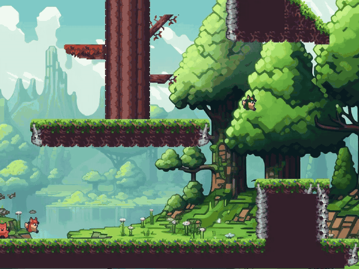

[Español](README.md)

# Hot Potato (Papa Caliente)

A networked multiplayer platformer for 2 to 4 players. Each round someone holds the hot potato, and when time runs out, everyone who doesn't have it scores a point.



> **Finished** · v1.0.0 · Windows and Linux · Spanish interface · Play it on itch: [cgrassdev.itch.io/hot-potato](https://cgrassdev.itch.io/hot-potato)

## How to play

- One player hosts (*Host*) and the others join with the host's IP (*Join*), on the same computer or the same local network. Each player picks a different fox color and presses *Ready*.
- Rounds last 60 seconds and are played on random maps. There are six, and none repeats until all of them have been played. If you don't have the potato when the round ends, you score a point.
- You pass the potato by touching another player while holding R, or by throwing it with Q. Whoever gets it is stunned for a moment. If you throw the potato and miss, you're lighter and run faster, but you have to go get it back.
- To get away you have a double jump, wall grab, roll, an upward boost and a fast fall.
- The first player to reach 5 points wins the match. On a tie, tiebreaker rounds are played only between the tied players, and the rest watch as ghosts.

| Action | Keyboard |
|---|---|
| Move | A / D |
| Jump (double jump) | Space |
| Crouch; in the air, fast fall | Shift |
| Roll | Shift while moving |
| Wall grab | S (in the air, against a wall) |
| Upward boost | W |
| Pass the potato by touch | R (hold) |
| Throw the potato | Q |
| Emote | E |

## Context

*Hot Potato* is the project for the Multiplayer Video Game Workshop course (Taller de Videojuegos Multijugador) at the University of Chile (second semester of 2024). Three of us made it: Diego San Martín, Nicolás del Valle and me. I mostly handled the visuals and the level design: the five new maps and their physics. I also programmed the round timer, the scoring and winner system, the rule that the previous round's loser doesn't start with the potato, the momentum-free movement, and the music. Diego programmed the fox and its moves, passing and throwing the potato, support for four players with colors, and the lobby, with its tutorial and credits. Nicolás made the potato collide with the level and limited it to one at a time, fixed the jump, and made the on-screen potato clock.

The game builds on the multiplayer template by the course professor, Elías Zelada: the lobby with *Host* and *Join*, and the `Game` and `Debug` autoloads. His commits in the history come from that template and predate the course.

In 2024 I committed as **past00**, my previous account; today it's [clemgrass](https://github.com/clemgrass).

## How it's built

| | |
|---|---|
| Engine | Godot 4.3 |
| Language | GDScript |
| Networking | ENet (`ENetMultiplayerPeer`), port 5409, up to 4 players |
| Platforms | Windows and Linux |

- **Each player owns their fox.** A fox's multiplayer authority is the player who controls it: that computer reads the keyboard, runs the physics and sends its position every frame (`send_position`), and the others interpolate it. Animations, sprite direction and collision shape changes (when crouching or rolling) are also sent over RPC.
- **A state machine for movement.** `StateMachine.gd` switches between eleven states (`states/`): idle, moving, jumping, falling, fast fall, crouch, roll, wall ride, boost, emote and stunned. Each state decides its own transitions from input and physics.
- **The server spawns the potato.** When throwing, the player asks the server to instantiate the potato in a `MultiplayerSpawner`, so everyone sees the same one. A pass is detected on the receiving side: the receiver's `Hurtbox` only listens on its own computer, and when the holder's reach or a thrown potato enters it, it stuns the receiver and transfers the potato over RPC.
- **The server runs the rounds.** The server runs the timer (`round_timer.gd`) and broadcasts it, shuffles the map order and adds up the points at the end of each round. On a tie at 5 or more, `points.gd` sets up the tiebreaker round and turns everyone else into spectators, without collisions and semi-transparent.

### 2026 changes

While preparing the repo for publishing:

- The final version was on the `master` branch, 64 commits ahead of `main`. It was merged into `main`.
- The lobby background showed up gray on any fresh clone: it pointed to Godot's cache of a file that had been moved to another folder. It now uses the image directly.
- On Linux the player name started empty because it was read from a Windows-only variable. It now also uses the Linux one and, if neither exists, "Player".
- Export presets for Windows and Linux were added (`export_presets.cfg` was in `.gitignore`).
- The project is now named "Papa Caliente" (it was `multiplayer_example`, the template's name), the controls menu says D instead of B for moving right, and 33 editor temp files were removed.

## Opening and exporting

You need [Godot 4.3](https://github.com/godotengine/godot/releases/tag/4.3-stable), the standard version (not .NET), with its export templates.

1. Open `project.godot` in Godot 4.3. The first time, it imports the resources.
2. To test on one computer, run the game twice (for example with the editor's *Debug → Customize Run Instances…*, or with two copies of the build). In one, press *Host*; in the other, *Join* with the IP `127.0.0.1`.
3. To play on a local network, the host shares their IP and allows UDP port 5409 through the firewall.

To export without opening the editor (the *Windows Desktop* and *Linux* presets are already in `export_presets.cfg`, with the `.pck` embedded in the executable), where `godot` is the Godot 4.3 executable:

```
mkdir -p builds/windows builds/linux
godot --headless --path . --export-release "Windows Desktop" builds/windows/HotPotato.exe
godot --headless --path . --export-release "Linux" builds/linux/HotPotato.x86_64
```

The v1.0.0 builds are in [Releases](https://github.com/clemgrass/HotPotatoMultiplayerGame/releases).

## Credits and license

Team:

- **Diego San Martín** ([DiegoSanma](https://github.com/DiegoSanma)): the fox and its state machine, passing and throwing the potato, four players with colors, lobby, tutorial and credits.
- **Clemente Grass Briones** ([clemgrass](https://github.com/clemgrass), formerly **past00**): level design and visuals, round timer, scoring and winner system, and music.
- **Nicolás del Valle** ([nico-del-valle](https://github.com/nico-del-valle), also Mariana-0412): potato collision with the level, one potato at a time, jump fixes and the potato clock.

Course: Multiplayer Video Game Workshop (Taller de Videojuegos Multijugador), University of Chile, second semester of 2024. Professor: **Elías Zelada** ([elixs](https://github.com/elixs)), author of the multiplayer template the game is built on.

Third-party assets used in the game:

- Fox: [Sunny Land](https://ansimuz.itch.io/sunny-land-pixel-game-art), by Luis Zuno (ansimuz) (CC0). The team recolored it into four versions.
- Map tiles: *Legacy Adventure Pack*, by [Anokolisa](https://anokolisa.itch.io) (free for commercial use, credit optional, according to the pack's note).
- Potato: *Free pixel food 16x16*, by Alex (alexkovacart) (CC BY 4.0).
- Map backgrounds: [Eder Muniz](https://edermunizz.itch.io) (use with credit).
- Smoke: *Pixel Art Effect - FX045*, by [NYKNCK](https://nyknck.itch.io) (@nyk_nck).
- Clock font: *Digital-7*, by Style-7 (free for personal use).
- Music: classical music mix from the [Parzibal Music](https://www.youtube.com/@parzibalmusic9615) channel.

**License:** the code is under the [MIT](LICENSE) license. It is the license of Elías Zelada's template the game is built on. Third-party assets remain under their own licenses, and the MIT license does not cover them.
