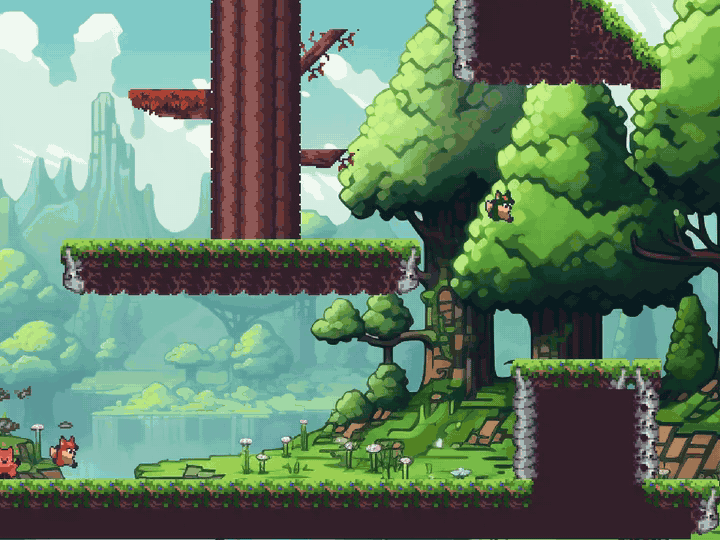

[English](README.en.md)

# Hot Potato (Papa Caliente)

Juego de plataformas multijugador en red para 2 a 4 jugadores. Cada ronda alguien tiene la papa caliente, y cuando se acaba el tiempo, todos los que no la tienen ganan un punto.



> **Terminado** · v1.0.0 · Windows y Linux · Interfaz en español · Juégalo en itch: [cgrassdev.itch.io/hot-potato](https://cgrassdev.itch.io/hot-potato)

## Cómo se juega

- Uno abre la partida (*Host*) y los demás se unen con su IP (*Join*), en el mismo computador o en la misma red local. Cada jugador elige un zorro de otro color y marca *Ready*.
- Las rondas duran 60 segundos y tocan mapas al azar. Hay seis, y no se repite ninguno hasta haber pasado por todos. Si al terminar la ronda no tienes la papa, ganas un punto.
- La papa se pasa tocando a otro jugador con R apretado, o lanzándola con Q. El que la recibe queda aturdido un momento. Si lanzas la papa y fallas, quedas más liviano y corres más rápido, pero tienes que ir a buscarla.
- Para escapar tienes doble salto, agarrarte de los muros, rodar, un impulso hacia arriba y caída rápida.
- Gana la partida el primero que llega a 5 puntos. Si hay empate, se juegan rondas de desempate solo entre los empatados, y los demás miran como fantasmas.

| Acción | Teclado |
|---|---|
| Moverse | A / D |
| Saltar (doble salto) | Espacio |
| Agacharse; en el aire, caída rápida | Shift |
| Rodar | Shift mientras te mueves |
| Agarrarse del muro | S (en el aire, contra un muro) |
| Impulso hacia arriba | W |
| Pasar la papa tocando | R (mantener) |
| Lanzar la papa | Q |
| Emote | E |

## Contexto

*Hot Potato* es el proyecto del ramo Taller de Videojuegos Multijugador de la Universidad de Chile (segundo semestre de 2024). Lo hicimos entre tres: Diego San Martín, Nicolás del Valle y yo. Yo me encargué sobre todo de lo visual y del diseño de niveles: los cinco mapas nuevos y sus físicas. También programé el temporizador de las rondas, el sistema de puntos y ganador, la regla de que el último que perdió no empieza con la papa, el movimiento sin inercia y la música. Diego programó al zorro y sus movimientos, el pase y el lanzamiento de la papa, el soporte para cuatro jugadores con colores y el lobby, con el tutorial y los créditos. Nicolás hizo que la papa choque con el escenario y que solo haya una a la vez, corrigió el salto e hizo el reloj de la papa en pantalla.

El juego parte de la plantilla de multijugador del profesor, Elías Zelada: el lobby con *Host* y *Join* y los autoloads `Game` y `Debug`. Sus commits del historial son de esa plantilla, anteriores al ramo.

En 2024 yo firmaba como **past00**, mi cuenta anterior; hoy es [clemgrass](https://github.com/clemgrass).

## Cómo está hecho

| | |
|---|---|
| Motor | Godot 4.3 |
| Lenguaje | GDScript |
| Red | ENet (`ENetMultiplayerPeer`), puerto 5409, hasta 4 jugadores |
| Plataformas | Windows y Linux |

- **Cada jugador manda sobre su zorro.** El zorro tiene como autoridad al jugador que lo controla: ese computador lee el teclado, corre la física y envía su posición en cada cuadro (`send_position`), y los demás la interpolan. Las animaciones, la dirección del sprite y los cambios de forma de la colisión (al agacharse o rodar) también viajan por RPC.
- **Una máquina de estados para el movimiento.** `StateMachine.gd` cambia entre once estados (`states/`): quieto, caminar, saltar, caer, caída rápida, agacharse, rodar, muro, impulso, emote y aturdido. Cada estado decide sus transiciones a partir del input y de la física.
- **La papa la crea el servidor.** Al lanzar, el jugador le pide al servidor que instancie la papa en un `MultiplayerSpawner`, así todos ven la misma. El pase se detecta en el que la recibe: su `Hurtbox` solo escucha en su propio computador, y cuando entra el alcance del que la tiene o la papa lanzada, lo aturde y transfiere la papa por RPC.
- **Las rondas las lleva el servidor.** El servidor corre el temporizador (`round_timer.gd`) y lo transmite a todos, baraja el orden de los mapas y suma los puntos al final de cada ronda. Si hay empate en 5 o más, `points.gd` arma la ronda de desempate y deja a los demás como espectadores, sin colisiones y semitransparentes.

### Cambios de 2026

Al preparar el repo para publicarlo:

- La versión final estaba en la rama `master`, 64 commits más adelante que `main`. Se unió a `main`.
- El fondo del lobby salía gris en cualquier clon nuevo: apuntaba a la caché de Godot de un archivo que se había movido de carpeta. Ahora usa la imagen directamente.
- En Linux, el nombre del jugador partía vacío porque se leía de una variable que solo existe en Windows. Ahora usa también la de Linux y, si no hay ninguna, "Player".
- Se agregaron los presets de exportación para Windows y Linux (`export_presets.cfg` estaba en `.gitignore`).
- El proyecto pasó a llamarse "Papa Caliente" (antes `multiplayer_example`, el nombre de la plantilla), el menú de controles dice D en vez de B para moverse a la derecha, y se quitaron 33 archivos temporales del editor.

## Abrirlo y exportarlo

Necesitas [Godot 4.3](https://github.com/godotengine/godot/releases/tag/4.3-stable), la versión estándar (no la .NET), con sus plantillas de exportación.

1. Abre `project.godot` en Godot 4.3. La primera vez importa los recursos.
2. Para probar en un solo computador, abre el juego dos veces (por ejemplo, con *Debug → Customize Run Instances…* del editor, o con dos copias del build). En una pulsa *Host*; en la otra, *Join* con la IP `127.0.0.1`.
3. Para jugar en red local, el que hace *Host* comparte su IP y deja pasar el puerto UDP 5409 en el firewall.

Para exportar sin abrir el editor (los presets *Windows Desktop* y *Linux* ya están en `export_presets.cfg`, con el `.pck` dentro del ejecutable), donde `godot` es el ejecutable de Godot 4.3:

```
mkdir -p builds/windows builds/linux
godot --headless --path . --export-release "Windows Desktop" builds/windows/HotPotato.exe
godot --headless --path . --export-release "Linux" builds/linux/HotPotato.x86_64
```

Los builds de la v1.0.0 están en [Releases](https://github.com/clemgrass/HotPotatoMultiplayerGame/releases).

## Créditos y licencia

Equipo:

- **Diego San Martín** ([DiegoSanma](https://github.com/DiegoSanma)): el zorro y su máquina de estados, el pase y el lanzamiento de la papa, cuatro jugadores con colores, lobby, tutorial y créditos.
- **Clemente Grass Briones** ([clemgrass](https://github.com/clemgrass), antes **past00**): diseño de niveles y lo visual, temporizador de rondas, sistema de puntos y ganador, y música.
- **Nicolás del Valle** ([nico-del-valle](https://github.com/nico-del-valle), también Mariana-0412): colisión de la papa con el escenario, una papa a la vez, arreglos del salto y el reloj de la papa.

Ramo: Taller de Videojuegos Multijugador, Universidad de Chile, segundo semestre de 2024. Profesor: **Elías Zelada** ([elixs](https://github.com/elixs)), autor de la plantilla de multijugador sobre la que se construyó el juego.

Assets de terceros que usa el juego:

- Zorro: [Sunny Land](https://ansimuz.itch.io/sunny-land-pixel-game-art), de Luis Zuno (ansimuz) (CC0). El equipo lo recoloreó en cuatro versiones.
- Tiles de los mapas: *Legacy Adventure Pack*, de [Anokolisa](https://anokolisa.itch.io) (libre para uso comercial, crédito opcional, según la nota del pack).
- Papa: *Free pixel food 16x16*, de Alex (alexkovacart) (CC BY 4.0).
- Fondos de los mapas: [Eder Muniz](https://edermunizz.itch.io) (uso con crédito).
- Humo: *Pixel Art Effect - FX045*, de [NYKNCK](https://nyknck.itch.io) (@nyk_nck).
- Fuente del reloj: *Digital-7*, de Style-7 (gratis para uso personal).
- Música: mix de música clásica del canal [Parzibal Music](https://www.youtube.com/@parzibalmusic9615).

**Licencia:** el código está bajo [MIT](LICENSE). Es la licencia de la plantilla de Elías Zelada sobre la que se construyó el juego. Los assets de terceros siguen bajo sus propias licencias, y la licencia MIT no los cubre.
